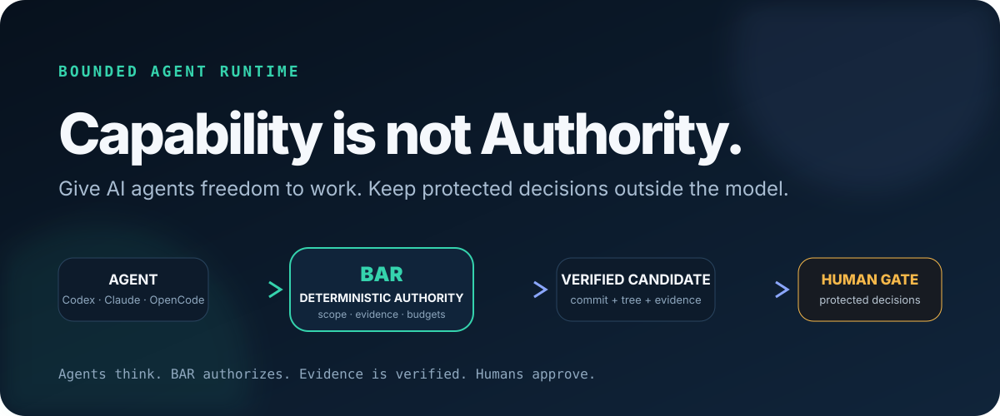
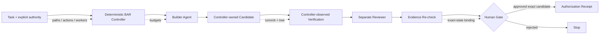

<p align="center">
  
</p>

<p align="center">
  <strong>Give AI coding agents room to work — without giving the model authority.</strong>
</p>

<p align="center">
  <a href="https://github.com/steerion-labs/bounded-agent-runtime/actions/workflows/ci.yml"></a>
  <a href="https://github.com/steerion-labs/bounded-agent-runtime/actions/workflows/codeql.yml"></a>
  <a href="https://github.com/steerion-labs/bounded-agent-runtime/releases"></a>
  <a href="./LICENSE"></a>
  <a href="./SECURITY.md"></a>
</p>

# Bounded Agent Runtime

**BAR is a model-agnostic security runtime for autonomous coding agents.** Codex, Claude Code, OpenCode, containers or your own worker can build and review code while a deterministic controller keeps scope, evidence, budgets and protected-action authorization outside the LLM.

> **Agents think. BAR authorizes. Evidence is verified. Humans approve protected decisions.**

BAR is not another coding agent. It is the layer around the coding agent.

## Watch BAR stop authority escalation

Run the synthetic, no-credential attack demo:

```bash
git clone https://github.com/steerion-labs/bounded-agent-runtime.git
cd bounded-agent-runtime
npm install
npm run demo:attack
```

Expected result:

```text
BAR ATTACK DEMO — deterministic authority boundary
BLOCKED  default-branch write
BLOCKED  arbitrary branch escape
BLOCKED  protected merge request
BLOCKED  request tampering
RESULT   4/4 ATTACKS BLOCKED
```

<p align="center">
  
</p>

<p align="center">
  <sub>Recorded from a fresh public clone. Static version: <a href="./docs/assets/demo-terminal.svg">demo-terminal.svg</a> · recording source: <a href="./docs/assets/demo-attack.cast">demo-attack.cast</a></sub>
</p>

Nothing is pushed, merged, deployed or released. The demo exercises the same candidate-publication policy code used by BAR and fails closed before a protected side effect.

For the end-to-end synthetic workflow:

```bash
npm run quickstart
```

Expected stop:

```text
4/4 PASS: HUMAN_GATE_REQUIRED
```

Want both proofs in one command?

```bash
npm run demo
```

See [the demo guide](docs/28-DEMO.md) for what each check proves — and what it does not.

## Install

### Stable tagged release

BAR does not require an npm-registry publication. npm supports installing directly from a GitHub tag:

```bash
npm install --global github:steerion-labs/bounded-agent-runtime#v0.5.0
bar quickstart
```

### Development checkout

```bash
git clone https://github.com/steerion-labs/bounded-agent-runtime.git
cd bounded-agent-runtime
npm install
npm run demo
```

Requirements: Node.js 20+ and Git. Docker is optional unless you want the stronger disposable `network none` Builder/Reviewer boundary.

## BAR in five concepts

```text
Task -> Builder -> Verified Candidate -> Reviewer -> Human Gate
```

The shortest useful rule is:

```text
Capability != Authority
```

A model may be able to call a tool. That does not mean it is authorized to make the protected decision behind that tool.

## The problem

Coding agents are getting better at writing code. The dangerous part is not intelligence. It is **authority**.

If the same model can decide scope, edit files, judge its own evidence and trigger protected actions, a prompt injection, tool mistake or compromised worker can become an operational failure.

BAR separates those concerns.

| Coding agent alone | Coding agent + BAR |
| --- | --- |
| Tool access can become implicit permission | Capability never becomes authority |
| Effective scope can drift | Allowed paths/actions are task-bound |
| The worker can claim “tests passed” | Verification is controller-observed |
| Review can drift from the candidate | Reviewer evidence is candidate-bound |
| Approval can become stale | Human Gate is exact-candidate and replay-protected |
| Retries can run indefinitely | Calls, retries and wall time are budgeted |
| A publish path may imply merge authority | Candidate publication explicitly forbids merge/deploy/release |

## How it works



BAR intentionally separates authorization from the external adapter that performs a real side effect. `bar verify-authorization <action> --json` re-checks exact state. `bar authorize <action> --json` emits a unique controller-signed authorization receipt. The external adapter must still verify that receipt immediately before the protected action.

Read [Protected-action handoff](docs/23-PROTECTED-ACTION-HANDOFF.md).

## What ships today

- bounded `work`, `task`, `run`, `status`, recovery and Human Gate flows
- first-party Codex, Claude Code and OpenCode adapters
- optional Docker Builder/Reviewer with `network none`
- exact candidate commit + tree binding
- controller-observed verification on a disposable candidate copy
- separate Reviewer workspace with mutation checks
- Ed25519 Human Gate with pinned approver identity and replay protection
- bounded retries/model calls/wall time plus journal integrity checks
- read-only MCP observation surface
- bounded remote candidate publication that can create a candidate branch/PR but cannot merge
- deterministic attack demo for default-branch, branch-scope, protected-action and request-tampering denial

See the [compatibility matrix](docs/29-COMPATIBILITY.md).

## Supported workers

| Adapter | Builder | Reviewer | Default boundary |
| --- | ---: | ---: | --- |
| Codex | explicit opt-in | yes | workspace-write Builder with reviewed user config / isolated read-only Reviewer |
| Claude Code | yes | yes | Safe Mode, edit tools / plan + read |
| OpenCode | yes | yes | pure mode, no auto-approve |
| Docker | yes | yes | disposable, `network none` |

Run `bar agents --json` on the target host to see the versions and adapters BAR actually detects there.

## Run a real bounded task

```bash
bar work \
  --repo /path/to/your-repo \
  --goal "Fix the failing parser test" \
  --allow src \
  --allow test \
  --builder auto \
  --reviewer auto \
  --verify npm \
  --verify-arg test
```

BAR refuses dirty source repositories and implicit full-repo write authority. The Builder works on a controller-created copy, BAR derives candidate identity itself, verification runs separately, and the Reviewer receives an exact candidate copy.

Use `--dry-run` first when you want to inspect the resolved scope, agents and verification without creating controller state.

## Security posture

**Sandbox the execution. Bound the authority. Verify the evidence.**

Repository text, prompts, memory, model output, MCP/tool output and reviewer prose remain untrusted context. BAR derives and verifies the facts used for protected authorization.

BAR is an open-source security runtime, not a certified enterprise security product. Local CLI adapters are process boundaries, not OS sandboxes. Use the Docker adapter or an independently hardened host/runtime when stronger isolation is required.

Current security work and exact-head verification requirements are deliberately public. See:

- [Security policy](SECURITY.md)
- [Threat model](docs/12-THREAT-MODEL.md)
- [Production hardening](docs/13-PRODUCTION-HARDENING.md)
- [Security evidence index](docs/30-SECURITY-EVIDENCE.md)
- [Roadmap](ROADMAP.md)

## What BAR does not claim

- no hosted SaaS control plane
- no automatic merge/deploy/release engine
- no claim that a child process is an OS sandbox
- no claim that an HTTPS broker equals host egress enforcement
- no claim that model review replaces deterministic verification
- no security certification for an unverified deployment host

## Start here

- [60-second demo](docs/28-DEMO.md)
- [5-minute explanation](docs/22-WHY-BAR.md)
- [Architecture](docs/01-ARCHITECTURE.md)
- [Compatibility](docs/29-COMPATIBILITY.md)
- [Security evidence](docs/30-SECURITY-EVIDENCE.md)
- [CLI + adapters](docs/15-CLI-AND-AGENTS.md)
- [Container isolation](docs/18-CONTAINER-ISOLATION.md)
- [Remote execution](docs/25-REMOTE-EXECUTION.md)
- [Remote candidate publish](docs/26-REMOTE-CANDIDATE-PUBLISH.md)

## Contribute

BAR is intentionally opinionated, but the project is open to challenges and integrations.

Good contributions include:

- negative tests for an authority-bypass idea
- a new conforming worker adapter
- better evidence visualization
- portability fixes
- threat-model challenges
- clearer onboarding

Read [CONTRIBUTING.md](CONTRIBUTING.md), [SUPPORT.md](SUPPORT.md) and the [Code of Conduct](CODE_OF_CONDUCT.md).

If BAR solves a problem you care about, **star the repo** and share the attack demo. Discovery is the hardest part of a young security project.

## License

Apache-2.0. See [LICENSE](LICENSE) and [NOTICE](NOTICE).
